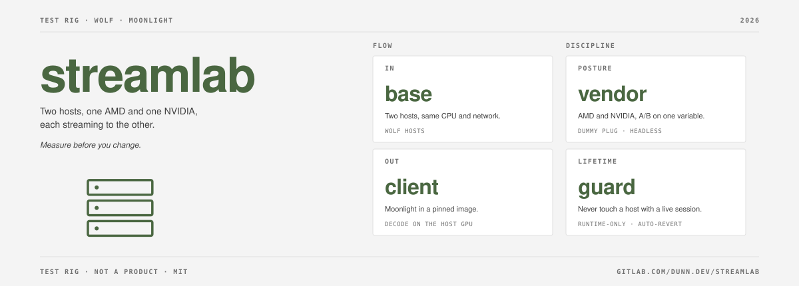

# streamlab

[](https://gitlab.com/dunn.dev/streamlab/-/pipelines)
[](LICENSE)
[](https://gitlab.com/dunn.dev)

A reproducible end-to-end test rig for Wolf game-streaming hosts and Moonlight clients.

## What this is

Two hosts with the same CPU on the same network, one with an AMD GPU and one with an
NVIDIA GPU, each running [Wolf](https://github.com/games-on-whales/wolf). An HDMI dummy
plug on each discrete GPU lets either host act as a headless Moonlight client for the
other. The rig measures regressions and settings before they reach anyone playing.

The method, including what it does not measure, is in [METHOD.md](METHOD.md).

## What is here

- `client/Containerfile`: a pinned Fedora image with moonlight-qt built from source against
  RPM Fusion ffmpeg. The NVIDIA userspace is injected at run time through CDI.
- `bin/streamlab`: a bash driver run from a workstation over ssh.
- `scripts/assert-client.sh`: the build-time checks for the client image.
- `tests/`: parser tests against fixture logs.
- `results/`: result TSVs, committed per baseline.

## Use

Hosts are arguments. The workstation needs ssh and passwordless sudo on both hosts, and
`jq` locally. Each host needs podman and a `wolf-idle-gate.sh` that exits non-zero while a
session is live.

```sh
bin/streamlab guard HOST_A HOST_B
bin/streamlab pair --server HOST_A --server-addr ADDR_A --client HOST_B
bin/streamlab run --server HOST_A --server-addr ADDR_A --client HOST_B \
  --app "Test ball" --codec HEVC --res 1920x1080 --fps 60 --bitrate 20000 \
  --secs 30 --runs 3 --out results/baseline.tsv
bin/streamlab parse results/logs/some-run.log
tests/test-parse.sh
```

## Build and release

CI builds the client image with the `container-image` component from
[dunn.dev/pipeline](https://gitlab.com/dunn.dev/pipeline) and publishes
`registry.gitlab.com/dunn.dev/streamlab/client`. Merge requests that touch `client/` or
`scripts/` build the image without pushing.

## License

MIT. See [LICENSE](LICENSE). moonlight-qt and the RPM Fusion codecs carry their own licenses.
